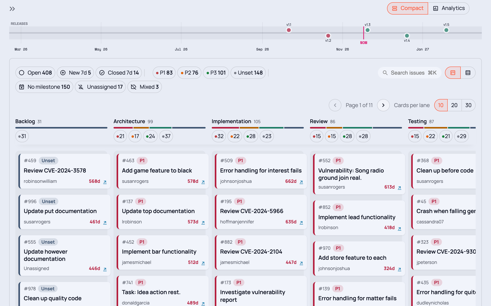
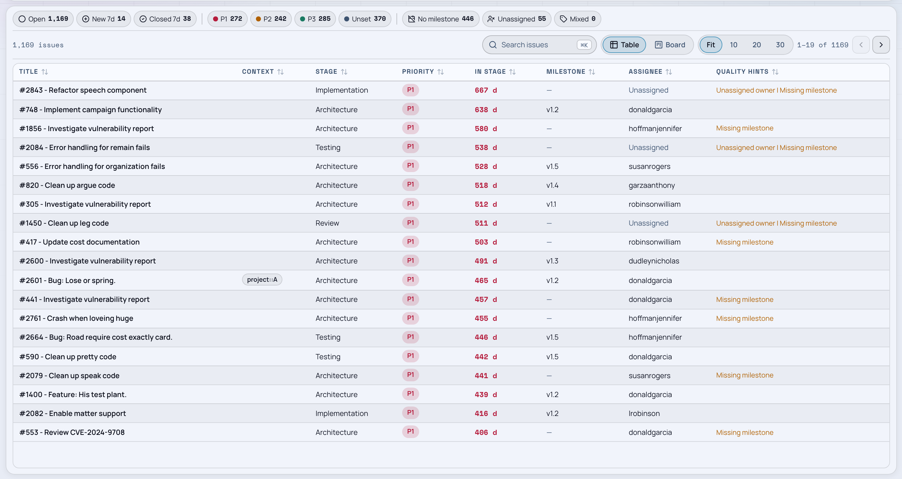
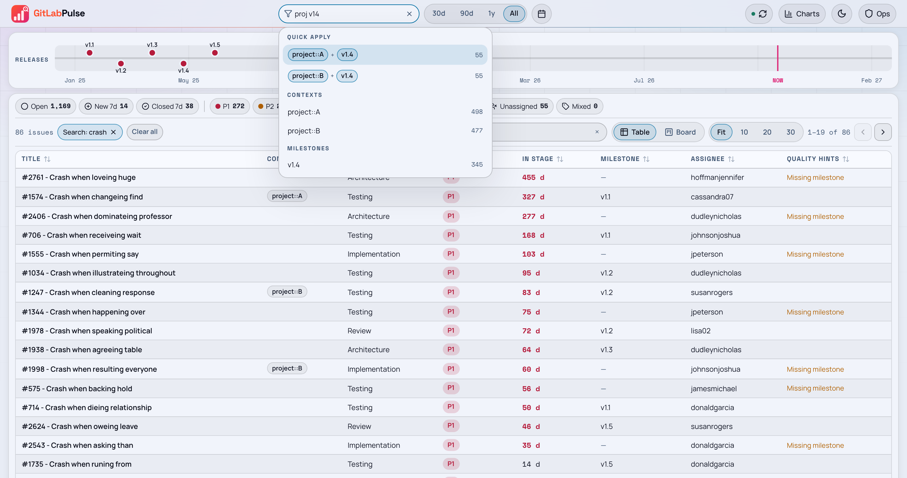
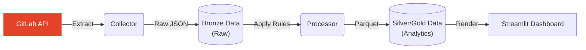

# GitLab Pulse

GitLab Pulse is a Streamlit analytics application for GitLab issue data. It extracts data via the GitLab API, applies custom workflow mapping rules, and generates analytical dashboards. It is designed to be hosted on a local PC or internal server, allowing users to access the dashboard through their web browser.

## Features

- **Analytics Dashboards**: Visualizes workflow state, issue velocity, and priority distribution.
- **Interactive Data Filtering**: Charts support drill-down filtering to inspect the underlying issue data.
- **Customizable Workflows**: Uses YAML configuration to map existing GitLab labels to standardized semantic workflow stages.

---

## Visual Insights

### Two layouts
Two layouts share one issue board. **Compact** (default) puts the board first for daily triage; **Analytics** shows the release timeline and the charts (priority, daily new vs. closed, quality signals, workflow state) above the board for reviews. Switch between them at the top right of the page. The filter and the layout are kept in the URL.

<picture>
  <source media="(prefers-color-scheme: dark)" srcset="docs/images/screenshots/hp_compact_dark.png">
  
</picture>

<picture>
  <source media="(prefers-color-scheme: dark)" srcset="docs/images/screenshots/hp_analytics_dark.png">
  
</picture>

### Board and table
Each board lane shows its stage's priority mix; pick a priority there, or a pill in the summary line above the board, to filter the board. The toolbar, the page bar and the lane headers stay pinned while you scroll. The issue list opens as a table; both show 10, 20 or 30 issues per page.

<picture>
  <source media="(prefers-color-scheme: dark)" srcset="docs/images/screenshots/hp_board_dark.png">
  
</picture>

<picture>
  <source media="(prefers-color-scheme: dark)" srcset="docs/images/screenshots/hp_table_dark.png">
  
</picture>

### Search
Press Ctrl+K (⌘K on macOS) to focus the search field in the toolbar; the board filters as you type, with fuzzy matching across title, assignee, context, milestone, priority and stage.

<picture>
  <source media="(prefers-color-scheme: dark)" srcset="docs/images/screenshots/hp_search_dark.png">
  
</picture>

### Charts as filters
In the Analytics layout, a click on a bar, a donut slice, a day or a quality signal filters the board below; a second click clears it.

<picture>
  <source media="(prefers-color-scheme: dark)" srcset="docs/images/screenshots/hp_chart_filter_dark.png">
  
</picture>

---

## Architecture

GitLab Pulse implements a standard **Medallion Data Architecture** (Bronze ➡️ Silver ➡️ Gold) for data processing.



### Example Workflow Mapping

The repository includes a template configuration (`app/config/rules/default.yaml`) that maps standard labels to a lifecycle. For instance, the label `workflow::implementation` is mapped to the "Active" phase.

Visualize exactly where issues are sitting across your custom lifecycle stages on the dashboard:

```mermaid
stateDiagram-v2
    direction LR
    [*] --> Backlog: No Workflow Label
    Backlog --> Architecture: architecture
    Architecture --> Implementation: implementation
    Implementation --> Review: review
    Review --> Testing: test
    Testing --> Done: done
    Done --> [*]

    classDef active fill:#1a7a62,color:white,stroke:none
    classDef waiting fill:#b06000,color:white,stroke:none
    classDef completed fill:#8a0ea8,color:white,stroke:none
    classDef backlog fill:#3d5370,color:white,stroke:none

    Backlog ::: backlog
    Architecture ::: active
    Implementation ::: active
    Review ::: waiting
    Testing ::: waiting
    Done ::: completed
```

<picture>
  <source media="(prefers-color-scheme: dark)" srcset="docs/images/screenshots/hp_board_dark.png">
  
</picture>



---

## Quick Start (Synthetic Demo)

To evaluate the dashboard without configuring API access to a live GitLab instance, you can generate synthetic project data locally.

### Prerequisites
- **Python**: `>=3.11`
- **Package Manager**: [`uv`](https://docs.astral.sh/uv/)

### Native Setup (Mac/Linux/WSL)
Run the automated setup script. It will verify prerequisites, install dependencies, and offer to generate local test data automatically.

```bash
./setup.sh
```

### Docker Evaluation
If you prefer not to install Python locally, you can spin up the entire stack, including synthetic data generation, via Docker:

```bash
cp .env.example .env
docker compose up --build
```
*Your dashboard will be available at `http://localhost:8501`.*

---

## Connecting Live GitLab Data

Once you are ready to analyze your actual projects, the transition is simple:

### 1. Configure the Environment
Copy the example environment file and fill in your GitLab URL and Token.
```bash
cp .env.example .env
```
Ensure you provide a Personal Access Token with the `read_api` scope, and specify the `PROJECT_IDS` (comma-separated) you want to sync.

### 2. Configure Your Rules
The `app/config/rules/default.yaml` file is a **template and example configuration**. It determines how issues are classified (Bug, Feature, etc.), validated, and grouped.

*   **Action**: Create your own YAML file (e.g., `my_project.yaml`) in `app/config/rules/`.
*   **Guidance**: Map your team's specific GitLab labels to the workflow stages. You can restrict rules to specific projects by defining `project_ids` inside the YAML file.

### 3. Run the Pipeline
Fetch the data, process it into analytics, and launch the dashboard:

```bash
# 1. Extract data from GitLab API
uv run python app/collector/orchestrator.py

# 2. Transform into Parquet analytics
uv run python app/processor/main.py

# 3. Launch the dashboard
uv run streamlit run app/dashboard/main.py
```

---

## Data Management & Testing

If you are developing locally and want to manage your synthetic datasets, use the built-in terminal manager:

```bash
uv run python tools/local_data_manager.py
```
This CLI allows you to reseed specific projects, clear data lakes, and adjust the assignment rates or team sizes for realistic testing. 

> 🤖 **AI Support**: A dedicated `SKILL.md` is provided in the repository to help AI assistants automatically detect, manage, and interact with the local data manager script on your behalf.

---

## Security & Deployment

- **Least Privilege**: The `GITLAB_TOKEN` only requires `read_api`. The collector never requests write permissions.
- **Persistent Storage**: If deploying via Docker, ensure the `./data` directory is mapped to a persistent volume. This holds your compiled Parquet data and sync state.
- **Intranet Ready**: The Streamlit dashboard is designed for internal team use or corporate VPNs. It contains an optional `ADMIN_PASSWORD` (set in `.env`) for administrative actions like manually extracting data from GitLab API and transforming it into Parquet analytics.

---

## Documentation

For deep technical insights, system architecture, and operational procedures, please refer to the comprehensive guides located in the `docs/guidelines/` directory:

- **[Developer Guidelines (docs/guidelines/GUIDE_Developer.md)](docs/guidelines/GUIDE_Developer.md)**: Details the core philosophy, coding standards, design patterns (Strategy, Factory, Singleton), and Streamlit configuration rules required for contributing to the codebase.
- **[Operations Guide (docs/guidelines/GUIDE_Operations.md)](docs/guidelines/GUIDE_Operations.md)**: Explains the data update lifecycle, caching mechanisms, the UI-based Admin Panel, project auto-discovery, and how to automate pipeline runs using cron.

---

## License

MIT
