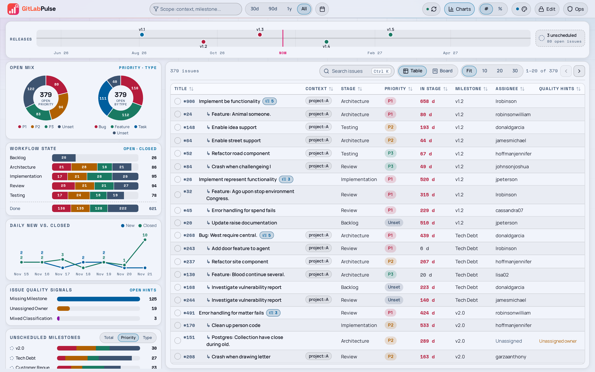
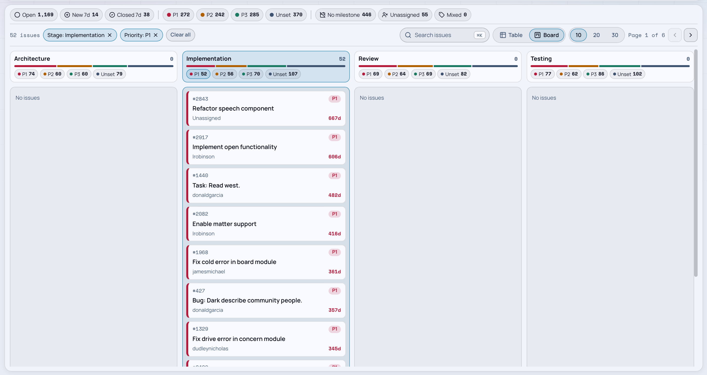
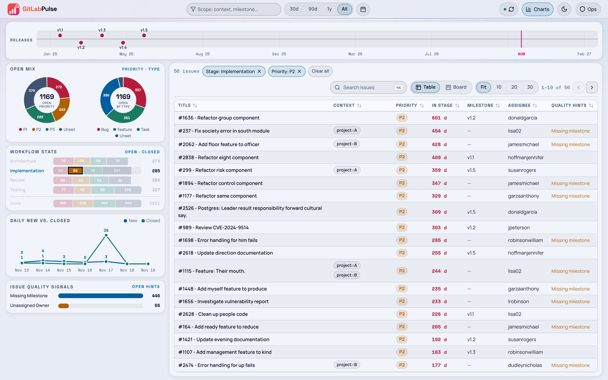
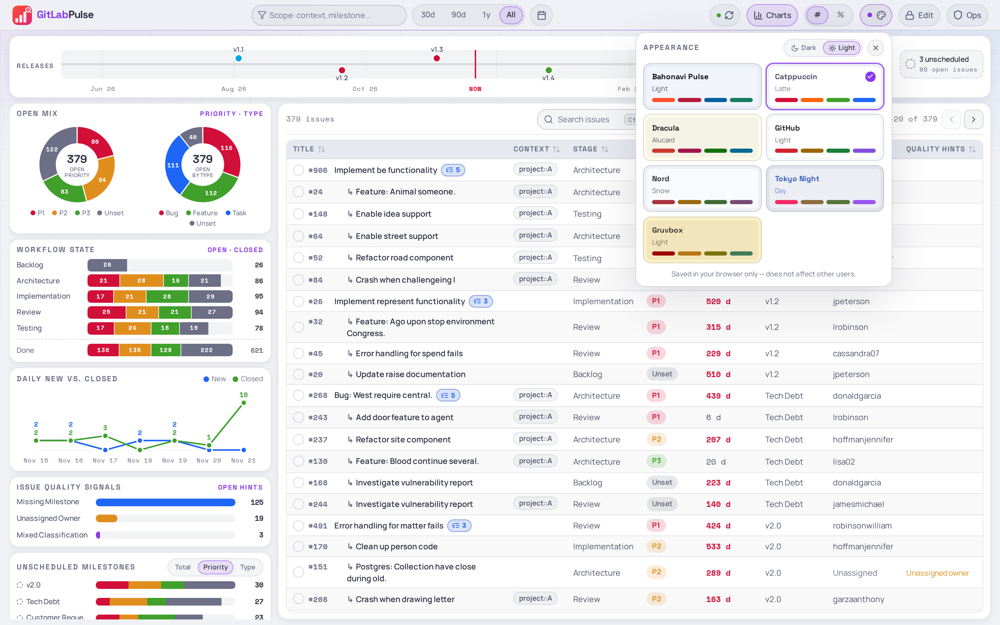
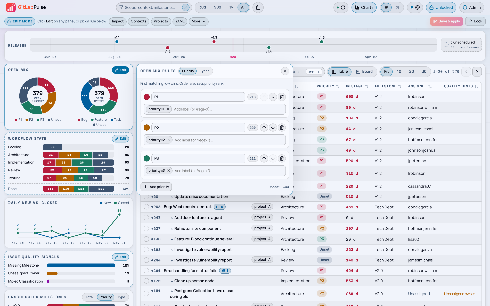
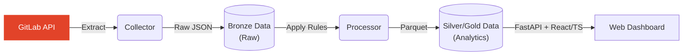

# GitLab Pulse

GitLab Pulse is a local-first analytics application for GitLab issue data. It extracts data via the GitLab API, applies custom workflow mapping rules, and serves a FastAPI + React/TypeScript dashboard. It is designed to run on a local PC or internal server, allowing teams to inspect issue flow through their web browser.

## Features

- **Analytics Dashboards**: Visualizes workflow state, issue velocity, priority/type mix, unscheduled milestones, and quality hints.
- **Interactive Data Filtering**: Charts support drill-down filtering to inspect the underlying issue data in a table or Kanban board.
- **In-Dashboard Rule Editing**: Unlock edit mode directly on the dashboard to map labels to workflow stages, issue types, impact levels, priorities, contexts, and quality checks—or edit YAML directly while preserving comments.
- **Personal Light & Dark Themes**: Every user can pick from Bahonavi Pulse, Catppuccin (Mocha/Latte), Dracula (Dark/Alucard), GitHub, Nord, Tokyo Night (Night/Day), and Gruvbox in the top bar without admin access.

**Live demo:** <https://bleviet.github.io/gitlab-pulse/demo/> (read-only, synthetic data, rebuilt weekly). To build it locally, seed and process synthetic data first (see Quick Start), then run `cd frontend && npm run build:demo && cd ..`, write the payload from the repository root with `uv run python tools/export_demo_payload.py --output frontend/dist-demo/demo-data/dashboard.json`, and serve `frontend/dist-demo/` under the path `/gitlab-pulse/demo/` (for example, copy it to `site/gitlab-pulse/demo/` and run `python -m http.server` in `site/`).

---

## Visual Insights

### One workspace, toggleable charts
GitLab Pulse renders a single-viewport Overview workspace with a persistent Release Timeline rail, a unified tokenized scope bar in the top navigation bar (type `proj v14` to quick-apply context and milestone together), and a **Charts** toggle. Keep **Charts** on (default) for `Open Mix` (`Priority · Type`), `Workflow State` (open stages and closed `Done` with inline priority counts), `Daily New vs. Closed`, `Issue Quality Signals`, and `Unscheduled Milestones` (open issues of milestones without a due date, shown beneath the quality signals in the wide layout, or in a popover from the release rail tray otherwise); toggle **Charts** off (`?view=compact`) to reveal quick-filter summary pills and maximize space for the issue table or board. Scopes, facets, search, and chart visibility all stay synced in the URL. A `#` / `%` switch next to **Charts** shows chart numbers as counts or as percentages; the choice is stored in the browser, not in the URL.

<picture>
  <source media="(prefers-color-scheme: dark)" srcset="docs/images/screenshots/hp_analytics_dark.png">
  
</picture>

<picture>
  <source media="(prefers-color-scheme: dark)" srcset="docs/images/screenshots/hp_compact_dark.png">
  
</picture>

### Board and table
Each board lane shows its stage's priority mix; pick a priority there, or a pill in the summary line above the board, to filter the board. The toolbar, the page bar and the lane headers stay pinned while you scroll. The issue list opens as a table with as many rows as fit in the window (Fit, or 10, 20 or 30 per page); the board shows 10, 20 or 30 cards per lane. A card's title or a row's title opens the issue in GitLab in a new tab.

<picture>
  <source media="(prefers-color-scheme: dark)" srcset="docs/images/screenshots/hp_board_dark.png">
  
</picture>

<picture>
  <source media="(prefers-color-scheme: dark)" srcset="docs/images/screenshots/hp_table_dark.png">
  
</picture>

### Search
Use the TopBar scope bar to fuzzy-search `Context`, `Milestone`, or `Team` (`proj v14`), or press `Ctrl+K` (`⌘K` on macOS) to focus the toolbar issue search field with typo-tolerant matching across title, assignee, context, milestone, priority, and stage.

<picture>
  <source media="(prefers-color-scheme: dark)" srcset="docs/images/screenshots/hp_search_dark.png">
  
</picture>

### Charts as filters
With Charts on, clicking a donut slice or legend item, a workflow-state bar segment or stage name (open or `Done`), a velocity day point, or a quality signal filters the issue list in place; clicking the active element again clears it.

<picture>
  <source media="(prefers-color-scheme: dark)" srcset="docs/images/screenshots/hp_chart_filter_dark.png">
  
</picture>

### Personal light & dark themes
Every user can open the top-bar **Appearance** picker (no admin access needed) to switch between Dark and Light mode and choose among **Bahonavi Pulse**, **Catppuccin** (Mocha/Latte), **Dracula** (Dark/Alucard), **GitHub**, **Nord**, **Tokyo Night** (Night/Day), and **Gruvbox**. Selections stay in each user's browser (`localStorage`).

<picture>
  <source media="(prefers-color-scheme: dark)" srcset="docs/images/screenshots/hp_themes_dark.png">
  
</picture>

### In-dashboard rule editing
Unlock **Edit** in the top bar to reveal panel edit buttons and a slim edit bar. Anchored popovers let you edit priorities, issue types, impact levels, workflow stages, contexts, and quality checks with live issue counts and inline color swatches—or switch to **YAML** to edit the rule file directly while preserving comments.

<picture>
  <source media="(prefers-color-scheme: dark)" srcset="docs/images/screenshots/hp_rule_edit_dark.png">
  
</picture>

---

## Architecture

GitLab Pulse implements a standard **Medallion Data Architecture** (Bronze -> Silver -> Gold) for data processing.



### Example Workflow Mapping

The repository includes a template configuration (`app/config/rules/default.yaml`) that maps standard labels to a lifecycle. For instance, the label `workflow::implementation` is mapped to the "Active" phase.

Visualize exactly where issues are sitting across your custom lifecycle stages on the dashboard:

```mermaid
stateDiagram-v2
    direction LR
    [*] --> Backlog: No Workflow Label
    Backlog --> Architecture: architecture
    Architecture --> Implementation: implementation
    Implementation --> Review: review
    Review --> Testing: test
    Testing --> Done: done
    Done --> [*]

    classDef active fill:#1a7a62,color:white,stroke:none
    classDef waiting fill:#b06000,color:white,stroke:none
    classDef completed fill:#8a0ea8,color:white,stroke:none
    classDef backlog fill:#3d5370,color:white,stroke:none

    Backlog ::: backlog
    Architecture ::: active
    Implementation ::: active
    Review ::: waiting
    Testing ::: waiting
    Done ::: completed
```

<picture>
  <source media="(prefers-color-scheme: dark)" srcset="docs/images/screenshots/hp_board_dark.png">
  
</picture>



---

## Quick Start (Synthetic Demo)

To evaluate the dashboard without configuring API access to a live GitLab instance, you can generate synthetic project data locally.

### Prerequisites
- **Python**: `>=3.11`
- **Package Manager**: [`uv`](https://docs.astral.sh/uv/)
- **Node.js**: `>=20` (for building the React/TypeScript frontend)

### Native Setup (Mac/Linux/WSL)
Run the automated setup script. It will verify prerequisites, install dependencies, and offer to generate local test data automatically.

```bash
./setup.sh
```

### Docker Evaluation
If you prefer not to install Python locally, you can spin up the entire stack, including synthetic data generation, via Docker:

```bash
cp .env.example .env
docker compose up --build
```
*Your dashboard will be available at `http://localhost:8501`.*

---

## Connecting Live GitLab Data

Once you are ready to analyze your actual projects, the transition is simple:

### 1. Configure the Environment
Copy the example environment file and fill in your GitLab URL and Token.
```bash
cp .env.example .env
```
Ensure you provide a Personal Access Token with the `read_api` scope, and specify the `PROJECT_IDS` (comma-separated) you want to sync.

### 2. Configure Your Rules
Rules determine how issues are classified (Bug, Feature, etc.), which labels place an issue in which workflow stage, how issues are grouped into contexts, and which quality checks apply.

**In the dashboard (no file editing):** click **Edit** (`Lock`) in the top bar and enter the admin password (`ADMIN_PASSWORD`, default `admin`) to unlock direct edit mode. Rule-backed panels (**Open Mix**, **Workflow State**, **Issue Quality Signals**, and the **ScopeBar**) display an **Edit** button that opens an anchored popover right next to the chart, while the edit bar at the top gives quick access to **Impact**, **Contexts**, **Projects**, **YAML** (direct YAML editor preserving comments), **Rule colours**, and **Earlier versions**. Each row shows live before/after issue counts and an inline colour swatch for the active theme. **Save & apply** writes the rules, re-runs the processor, and reloads the dashboard.

**Personal appearance themes:** click the palette button in the top bar (no admin login needed) to switch between **Dark / Light** mode and popular personal themes (**Bahonavi Pulse**, **Catppuccin Mocha/Latte**, **Dracula / Alucard**, **GitHub**, **Nord**, **Tokyo Night / Day**, and **Gruvbox**). Choices are saved in your browser (`localStorage`) and do not affect other users.

**Several teams:** **More -> New team rule set** creates rules for one team and the projects you tick; all other projects keep using the default rule set. **Projects** changes the assignment later, and **Earlier versions** loads a previous version (or the version shipped with GitLab Pulse) back into the editor, where you can check its effect before saving.

**Starting from existing labels:** if your projects already use scoped labels such as `type::bug`, `impact::high` (or `severity::high`), `priority::1`, or `workflow::review`, **Suggest** in the type, impact, priority, and stage popovers proposes the matching rows. Inline swatches and **More -> Rule colours** change the default colours used for types, impacts, priorities, and stages in both themes.

**Where rules are stored:** `app/config/rules/default.yaml` is a read-only template. The first save from the dashboard copies the template rules to `data/rules/` and writes there from then on. `data/rules/` is gitignored and sits on the Docker data volume, so saved rules survive image rebuilds. The previous version of a file is kept in `data/rules/.history/` on every save.

**Direct YAML editing (in-browser or on disk):** click **YAML** in the edit bar (while unlocked) to view, copy, or edit the stored YAML directly—saving from the YAML editor validates syntax and rule constraints, preserves comments and formatting, and re-runs the processor automatically. You can also edit files directly on disk in `data/rules/` (or `app/config/rules/` before the first save) and run the processor manually. Comments are dropped only when saving through the structured form editors.

### 3. Run the Pipeline
Fetch the data, process it into analytics, and launch the dashboard:

```bash
# 1. Extract data from GitLab API
uv run python app/collector/orchestrator.py

# 2. Transform into Parquet analytics
uv run python app/processor/main.py

# 3. Build frontend (first time or after UI edits)
(cd frontend && npm ci && npm run build)

# 4. Launch the dashboard
uv run python -m app.dashboard
```

---

## Data Management & Testing

If you are developing locally and want to manage your synthetic datasets, use the built-in terminal manager:

```bash
uv run python tools/local_data_manager.py
```
This CLI allows you to reseed specific projects, clear data lakes, and adjust the assignment rates or team sizes for realistic testing. 

> **AI Support**: A dedicated `SKILL.md` is provided in the repository to help AI assistants automatically detect, manage, and interact with the local data manager script on your behalf.

---

## Security & Deployment

- **Least Privilege**: The `GITLAB_TOKEN` only requires `read_api`. The collector never requests write permissions.
- **Persistent Storage**: If deploying via Docker, ensure the `./data` directory is mapped to a persistent volume. This holds your compiled Parquet data and sync state.
- **Intranet Ready**: The FastAPI + React dashboard is designed for internal team use or corporate VPNs. It contains an optional `ADMIN_PASSWORD` (set in `.env`) for administrative actions like manually extracting data from GitLab API and transforming it into Parquet analytics.

---

## Documentation

For deep technical insights, system architecture, and operational procedures, please refer to the comprehensive guides located in the `docs/guidelines/` directory:

- **[Layer 3 Rewrite Documentation (docs/layer3-rewrite/README.md)](docs/layer3-rewrite/README.md)**: Diataxis guide (tutorial, how-to guides, reference, and architectural explanation) for the FastAPI + React/TypeScript Layer 3 rewrite.
- **[Developer Guidelines (docs/guidelines/GUIDE_Developer.md)](docs/guidelines/GUIDE_Developer.md)**: Details the core philosophy, coding standards, design patterns (Strategy, Factory, Singleton), and contribution conventions.
- **[Operations Guide (docs/guidelines/GUIDE_Operations.md)](docs/guidelines/GUIDE_Operations.md)**: Explains the data update lifecycle, caching mechanisms, the UI-based Admin Panel, project auto-discovery, and how to automate pipeline runs using cron.

---

## License

MIT
